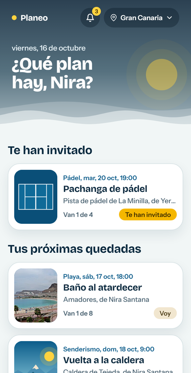
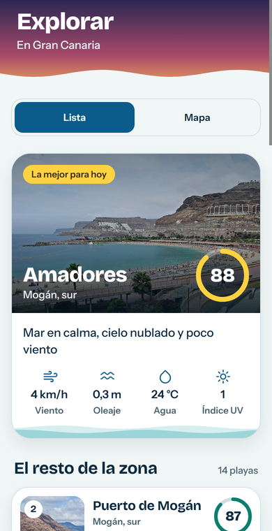
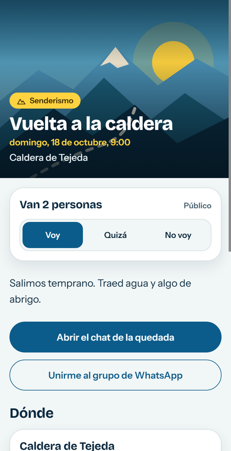
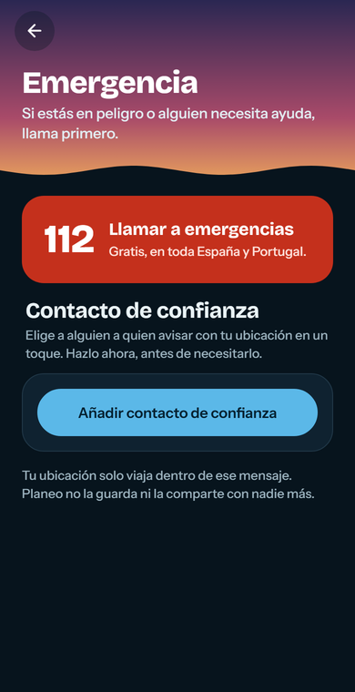
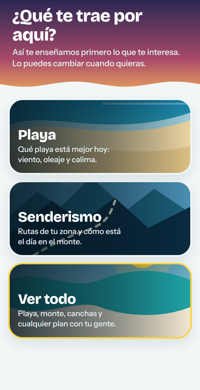

# Planeo

**Planeo** is a mobile app for organising outdoor plans with friends: a swim at the beach, a hike,
a football or padel match, a dance or pilates class. It tells you which beaches and trails are at
their best today, lets you create meetups at a real place, invite friends or a group, and chat
with everyone who is going.

It started in Gran Canaria and covers the Canary Islands, the Balearic Islands, mainland Spain and
Portugal. The interface is in Spanish.

> Personal project, built end to end. Working prototype, not published on the app stores.

<p>
  
  
  
</p>
<p>
  
  
  
</p>

<sub>Screenshots taken from the web preview of the app with test data. On a phone the tab bar sits at
the bottom and uses the native component of each platform.</sub>

## What it does

- **Today's best spots.** Every beach and trail gets a daily score from live weather, sea state,
  water temperature, UV and Saharan dust (*calima*), adjusted to your preferences. The best one
  is highlighted with an illustrated forecast for the next hours.
- **Meetups for any activity.** Beaches, ~450 hiking routes and ~830 football, basketball and
  padel courts in the Canary Islands come from open data. Dance, pilates or anything else can be
  placed by hand; its exact address is only shown to people who are going.
- **Friends, groups and invitations.** Friend requests, private or public profiles, groups with
  admins, invitations to groups and meetups, and an optional WhatsApp group link.
- **Realtime chat.** Direct, group and meetup chats with typing indicator, read receipts and
  voice notes.
- **Notifications.** In-app and push: messages, invitations, someone joining your meetup, a change
  of time or place, a cancellation, and a reminder two hours before it starts.
- **Safety.** An SOS button opens the dialler with 112 or a WhatsApp/SMS message to a trusted
  contact with your current location. The location never leaves the phone except inside that
  message. Blocking, reporting and a moderation queue for every user and message.
- **Privacy and legal.** Terms that must be read to the end before signing up, data export,
  account deletion, and privacy policy, terms and community guidelines published in [`web/`](web).

## How it is built

| Layer | Technology |
| --- | --- |
| App | Expo SDK 57, React Native 0.86, TypeScript, Expo Router (native tabs), TanStack Query, Reanimated 4 |
| Backend | Supabase: PostgreSQL, Auth, Realtime, Storage and Edge Functions (Deno) |
| Data | Open-Meteo (weather, marine, air quality), Wikidata and OpenStreetMap (beaches, routes, courts) |

### Security first

The whole backend lives in **20 versioned SQL migrations**, and the database enforces the rules,
not the app:

- **Row-level security on every table**, with explicit policies. Blocking is applied everywhere:
  profiles, meetups, messages, voice notes and notifications.
- **257 automated database tests** (pgTAP) check who can read and write what, including the
  abuse cases.
- **Rate limits in the database** for messages, friend requests, invitations, meetups, groups and
  reports.
- Voice notes and photos in **private storage**, served through short-lived signed URLs only to
  people allowed to see the message.
- **Encrypted session** on the device (AES with the key in the system keychain).
- Push notifications are sent by a database trigger to an Edge Function protected by a shared
  secret; reminders run on `pg_cron`.

## Project structure

```
src/app          screens (Expo Router)
src/components   UI: sky header, illustrated scenes, cards, chat bubbles
src/social       friends, groups, chat, voice notes, meetups, notifications
src/scoring      daily beach and hiking scores (pure functions, unit tested)
src/seguridad    SOS: trusted contact and emergency message
supabase         migrations, pgTAP tests and Edge Functions
web              privacy policy, terms, community guidelines, account deletion
scripts          data importers (Wikidata, OpenStreetMap) and legal text generator
```

## Running it locally

Requirements: Node 20+, Docker and the Expo Go app.

```bash
npm install
npx supabase start          # local database with every migration
cp .env.example .env.local  # your computer's LAN IP and the anon key from `npx supabase status`
npx expo start --go
```

Useful commands:

```bash
npm test                    # unit tests of the scoring functions
npx supabase test db        # database security tests
npm run db:tipos            # regenerate the database TypeScript types
```

Google sign-in and real push notifications need a development build (`eas build`); everything
else works in Expo Go.

## Data and credits

- Weather, sea and air quality: [Open-Meteo](https://open-meteo.com) (CC BY 4.0).
- Beaches: [Wikidata](https://www.wikidata.org) (CC0); photos from Wikimedia Commons under each
  file's licence.
- Hiking routes and courts: © [OpenStreetMap](https://www.openstreetmap.org/copyright)
  contributors (ODbL).

## Licence

**All rights reserved.** The code is public so it can be read and reviewed, not reused: it may
not be modified, re-uploaded, redistributed, run or used in another product without written
permission. See [LICENSE](LICENSE). Third-party data and dependencies keep their own licences.
